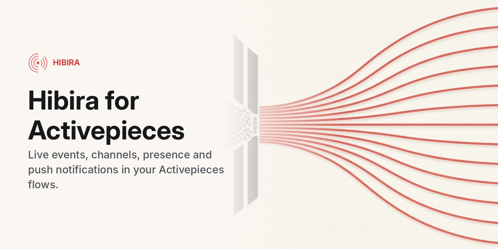

# Hibira piece for Activepieces



[Hibira](https://hibira.io) is a hosted realtime service that speaks the Pusher Channels and Beams protocols: WebSocket channels, presence and push notifications. This package adds Hibira to [Activepieces](https://www.activepieces.com) as a custom piece.

## Install

On a self-hosted Activepieces, open the admin settings, go to **Pieces** and choose **Install Piece**. Pick npm as the source and enter:

```
@hibira-io/piece-hibira
```

Leave the version empty for the latest release, or pin one such as `0.1.0`. The piece then shows up as **Hibira** in the flow builder.

## Connection

You need an app on [hibira.io](https://hibira.io/portal). The free plan is enough and needs no card.

- **App ID**, **Key** and **Secret**: from the app page.
- **API URL**: leave the default (`https://ws.hibira.io`) unless your app runs in another cluster.
- **Push instance ID** and **Push secret key**: from the app's Push tab, only for the push notification actions.

The connection is checked with a signed request when you save it.

## Actions

- **Send Event**: publish an event to up to 100 channels.
- **List Occupied Channels**, **Get Channel**, **Get Users in Presence Channel** (pages through `presence-large-` channels).
- **Disconnect User**: close every connection of a signed-in user.
- **Send Push Notification to Interests**, **Send Push Notification to Users**, **Delete Push User**.
- **Request Approval**, **Get Approval**: ask a person to approve or choose (2 to 4 choices, the first approves) through a Hibira-hosted answer link, optionally delivered by push or announced on a channel for the `@hibira-io/approvals` inbox. Request Approval can wait up to 9 minutes for the answer and returns `status` (`approved`, `rejected`, `pending`, `expired`) and `choice`; for longer waits, send the link and check later with Get Approval. Needs an app in a Hibira account.
- **Get Waiting Room**, **Create or Update Waiting Room**, **Admit Visitors**, **Verify Waiting Room Pass**, **Delete Waiting Room**: run a Hibira waiting room from a flow. Open or pause a room on a schedule, admit a batch when a sale starts, or check a visitor's pass (`hibira_pass` or the `hibira_wr_<room>` cookie) from a checkout webhook; record `ticket_id` to allow one checkout per place in line. Empty fields in Create or Update keep their current values. Needs the waiting room add-on.

### Recipe: supervisor approval for database changes

Reads run by themselves; a change waits for a supervisor who sees the exact statement and its plan. Activepieces keeps the database connection, so Hibira only carries the question and the answer.

1. A trigger brings the statement in `sql` (a webhook from your app, a form, or an agent).
2. A **Code** step marks reads, strictly: one statement, a read word first, no word that writes. Anything unsure is a change.

   ```ts
   import { createHash } from 'crypto';

   export const code = async (inputs: { sql: string }) => {
     const s = inputs.sql.trim().replace(/;\s*$/, '');
     const read = !s.includes(';')
       && /^(select|with|explain|show)\b/i.test(s)
       && !/\b(insert|update|delete|merge|create|alter|drop|truncate|grant|revoke|copy|call|into|analyze|set|nextval|setval|for\s+(update|share))\b/i.test(s);
     return { read, fingerprint: createHash('sha256').update(inputs.sql).digest('hex') };
   };
   ```

3. **Router**: if `read` → the Postgres or MySQL piece runs `sql` on a user that can only read.
4. Otherwise → run `EXPLAIN {{sql}}` (it does not run the statement) → **Request Approval** with Question `Run this change on the shop database?`, Details holding the statement, the plan and `SHA-256: {{fingerprint}}`, and Wait for Answer on. Push User IDs reach the supervisor's phone; a Channel shows the request and its answer live in your own app.
5. **Router** on `status` = `approved` → run `sql`. On `rejected`, send `comment` back to the requester. For answers that take longer than 9 minutes, turn Wait off and check with **Get Approval** from a later step or flow.

The same pattern with a web console and a phone approval page is the [database changes guide](https://hibira.io/use-cases/database-write-approvals).

## Trigger

- **New Channel Event**: channel occupied or vacated, presence member added or removed, client events, subscription count, cache miss and chat message. The trigger registers its own webhook on the app when the flow is turned on, removes it when the flow is turned off, and checks the signature of every call with the app secret (including the previous secret during a rotation).

## Develop

```sh
npm install
npm run typecheck
npm test
npm run build
```

Releases are published to npm by the `publish` workflow when a GitHub release is created.

## License

MIT
